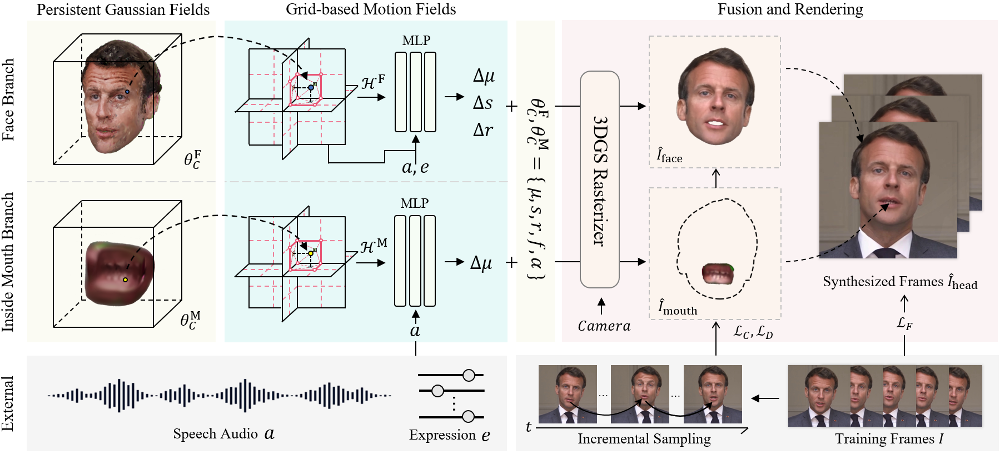

# TalkingGaussian：基于高斯泼溅的结构持久 3D 说话头合成

本仓库是我们 ECCV 2024 论文 **TalkingGaussian: Structure-Persistent 3D Talking Head Synthesis via Gaussian Splatting** 的官方代码库。

[论文](https://arxiv.org/abs/2404.15264) | [项目主页](https://fictionarry.github.io/TalkingGaussian/) | [视频](https://youtu.be/c5VG7HkDs8I)



## 安装

测试环境为 Ubuntu 18.04、CUDA 11.3、PyTorch 1.12.1

```
git clone git@github.com:Fictionarry/TalkingGaussian.git --recursive

conda env create --file environment.yml
conda activate talking_gaussian
pip install "git+https://github.com/facebookresearch/pytorch3d.git"
pip install tensorflow-gpu==2.8.0
```

如果在安装 `diff-gaussian-rasterization` 或 `gridencoder` 时遇到问题，请参考 [gaussian-splatting](https://github.com/graphdeco-inria/gaussian-splatting) 和 [torch-ngp](https://github.com/ashawkey/torch-ngp)。

### 准备

- 准备人脸解析（face-parsing）模型和用于头部姿态估计的 3DMM 模型。

  ```bash
  bash scripts/prepare.sh
  ```

- 从 [Basel Face Model 2009](https://faces.dmi.unibas.ch/bfm/main.php?nav=1-1-0&id=details) 下载 3DMM 模型：

  ```bash
  # 1. 将 01_MorphableModel.mat 复制到 data_util/face_tracking/3DMM/
  # 2. 执行下列命令
  cd data_utils/face_tracking
  python convert_BFM.py
  ```

- 准备 [EasyPortrait](https://github.com/hukenovs/easyportrait) 的运行环境：

  ```bash
  # 准备 mmcv
  conda activate talking_gaussian
  pip install -U openmim
  mim install mmcv-full==1.7.1

  # 下载模型权重
  cd data_utils/easyportrait
  wget "https://rndml-team-cv.obs.ru-moscow-1.hc.sbercloud.ru/datasets/easyportrait/experiments/models/fpn-fp-512.pth"
  ```

## 使用

### 重要声明

- 本代码仅供研究用途。作者不对代码的准确性、完整性或对特定用途的适用性作任何明示或暗示的保证。使用本代码的风险由使用者自行承担。

- 作者明确禁止将本代码用于任何恶意或非法活动。使用本代码即表示您同意遵守所有适用的法律法规，并同意不使用本代码伤害他人，也不进行任何被视为不道德或非法的行为。

- 对于因使用本代码而产生的任何损害、损失或问题，作者概不负责。

- 我们鼓励使用者以负责任且合乎伦理的方式使用本代码。

### 视频数据集
[此处](https://drive.google.com/drive/folders/1E_8W805lioIznqbkvTQHWWi5IFXUG7Er?usp=drive_link)提供了我们在实验中使用的两段视频片段，它们取自 YouTube。使用时请尊重原内容创作者的权益，并遵守 YouTube 的版权政策。

其他使用到的视频可从 [GeneFace](https://github.com/yerfor/GeneFace) 和 [AD-NeRF](https://github.com/YudongGuo/AD-NeRF) 获取。


### 预处理训练视频

* 将训练视频放到 `data/<ID>/<ID>.mp4`。

  视频**必须是 25FPS，且每一帧都要包含说话的人物**。
  分辨率应在 512x512 左右，时长约 1–5 分钟。

* 运行脚本处理视频。

  ```bash
  python data_utils/process.py data/<ID>/<ID>.mp4
  ```

* 获取动作单元（Action Units）
  
  在 [OpenFace](https://github.com/TadasBaltrusaitis/OpenFace) 中运行 `FeatureExtraction`，重命名输出的 CSV 文件并移动到 `data/<ID>/au.csv`。

* 生成牙齿掩码

  ```bash
  export PYTHONPATH=./data_utils/easyportrait 
  python ./data_utils/easyportrait/create_teeth_mask.py ./data/<ID>
  ```

### 音频预处理

在我们的论文中，评估时使用 DeepSpeech 特征。

* DeepSpeech

  ```bash
  python data_utils/deepspeech_features/extract_ds_features.py --input data/<name>.wav # 保存至 data/<name>.npy
  ```

- HuBERT

  与 ER-NeRF 类似，也可以使用 HuBERT。当音频不是英语时推荐使用。

  训练和测试时指定 `--audio_extractor hubert`。

  ```
  python data_utils/hubert.py --wav data/<name>.wav # 保存至 data/<name>_hu.npy
  ```

### 数据加载

默认情况下，我们会把所有数据预加载到内存中以加速，但内存开销可能难以承受（约 N x 5k 帧需要约 N x 32GB 内存）。

（实验性）你可以尝试在 `scene/dataset_readers.py - readCamerasFromTransforms(·)` 中设置 `preload=False`，改为每次迭代按需加载数据以节省开销。代价是速度可能会变慢。

### 训练

```bash
# 若资源充足，可以使用部分并行来加速训练。详见脚本。
bash scripts/train_xx.sh data/<ID> output/<project_name> <GPU_ID>
```

### 测试

```bash
# 保存至 output/<project_name>/test/ours_None/renders
python synthesize_fuse.py -S data/<ID> -M output/<project_name> --eval  
```

### 使用指定音频推理

```bash
python synthesize_fuse.py -S data/<ID> -M output/<project_name> --use_train --audio <preprocessed_audio_feature>.npy
```

## 后续工作
- [2025/02/28] 我们在 CVPR 2025 的工作 [InsTaG](https://fictionarry.github.io/InsTaG/) 已发布！🔥

## 引用

如果你觉得本仓库对你的项目有帮助，欢迎按下列格式引用：

```
@inproceedings{li2024talkinggaussian,
  title={TalkingGaussian: Structure-Persistent 3D Talking Head Synthesis via Gaussian Splatting},
  author={Li, Jiahe and Zhang, Jiawei and Bai, Xiao and Zheng, Jin and Ning, Xin and Zhou, Jun and Gu, Lin},
  booktitle={European Conference on Computer Vision},
  pages={127--145},
  year={2024},
  organization={Springer}
}
```


## 致谢

本代码基于 [gaussian-splatting](https://github.com/graphdeco-inria/gaussian-splatting) 和 [simple-knn](https://gitlab.inria.fr/bkerbl/simple-knn) 开发，并使用了修改版的 [diff-gaussian-rasterization](https://github.com/ashawkey/diff-gaussian-rasterization)。部分代码来自 [RAD-NeRF](https://github.com/ashawkey/RAD-NeRF)、[DFRF](https://github.com/sstzal/DFRF)、[GeneFace](https://github.com/yerfor/GeneFace) 和 [AD-NeRF](https://github.com/YudongGuo/AD-NeRF)。牙齿掩码来自 [EasyPortrait](https://github.com/hukenovs/easyportrait)。感谢这些优秀的项目！
